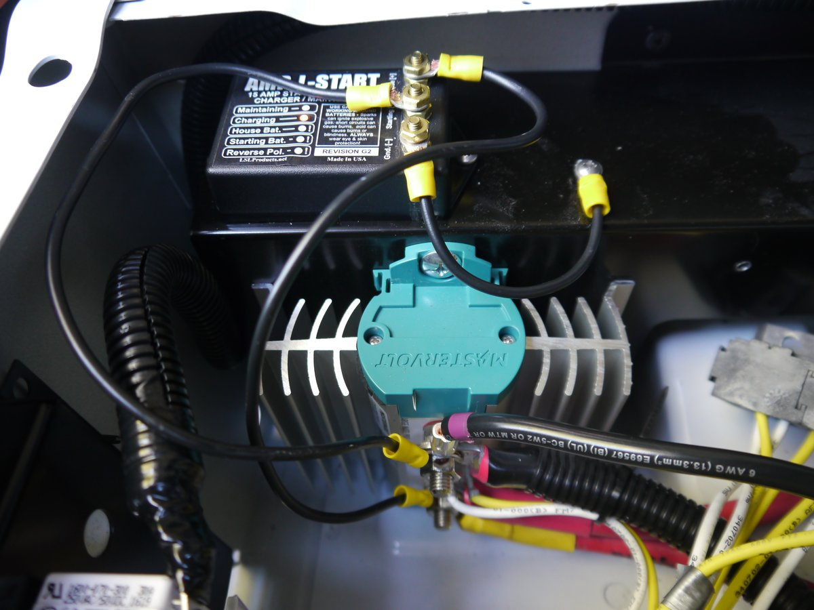
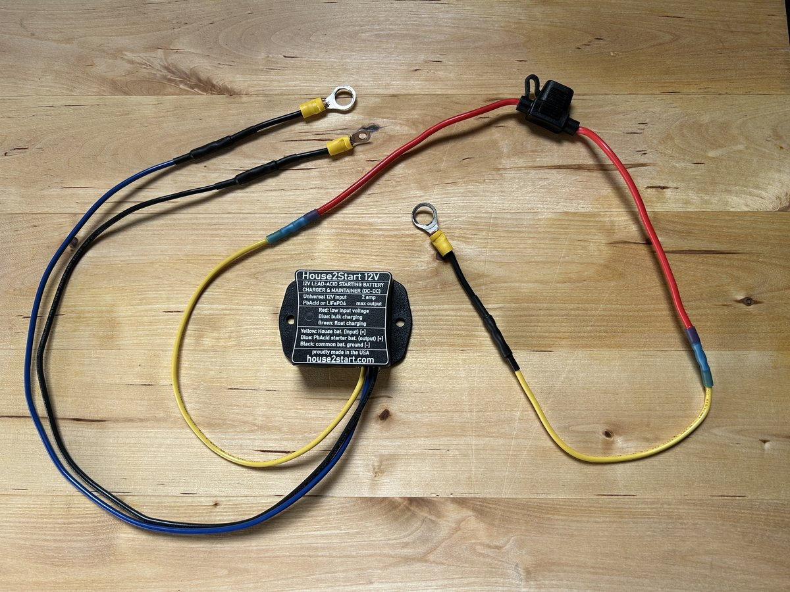
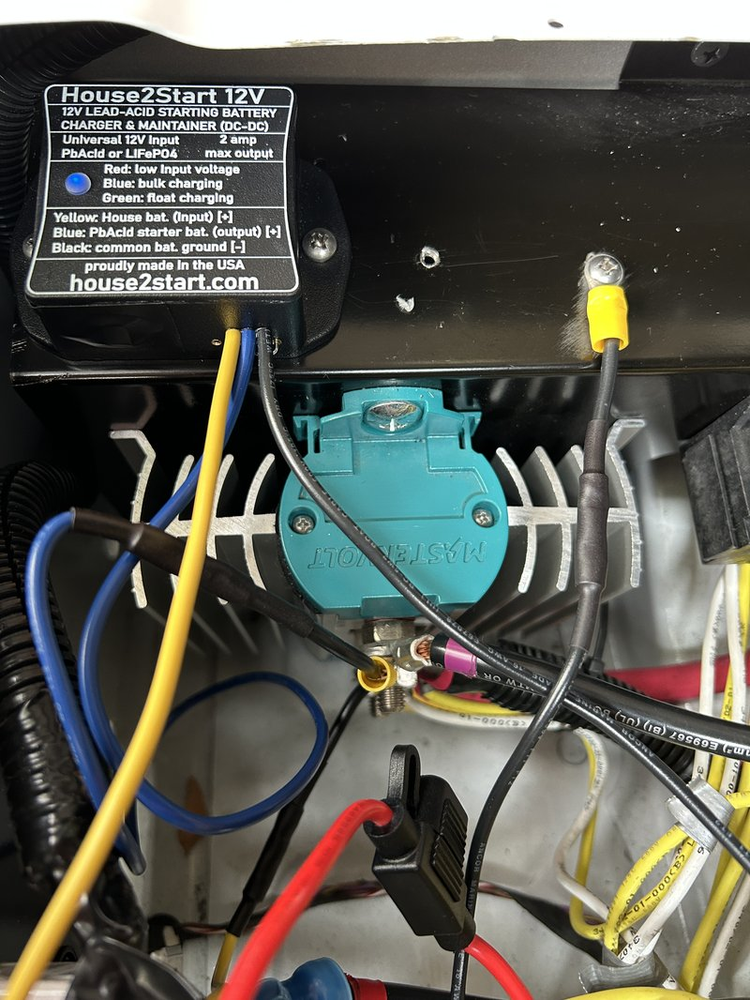

This mod was necessitated by the failure of the original chassis battery maintainer that we installed early on after our purchase of our 2021 View.  Our original mod was the installation of an Amp – L – Start, but after several years of inconsistent performance and then its eventual failure to do its job at keeping our Sprinter’s battery topped up – it was time to find a replacement system.

The role of our initial Amp – L - Start chassis battery maintainer was to act like a trickle charger for the Sprinter battery, borrowing a small amount of the charging current intended for the View’s house batteries and applying it to the Sprinter’s battery to keep it topped up during times of vehicle inactivity.  It was not a very sophisticated system, but the industry has seen very good results, for many years, from the Amp – L – Start and its little brother the Trik – L – Start.  Both of these systems, from the now defunct LSL Products of San Antonio, Texas, were very popular and were the go-to chassis battery maintainers for the RV mod world.  In our case, we had several good years before a flat chassis battery and a series of prior “head scratches” made us step back and look for a replacement.

The replacement we chose was the House2Start battery charger and maintainer.  It is advertised as a direct replacement, plug and play - for either of the old LSL maintainer products - and I can report that those claims are indeed true.  It was a very straightforward replacement, and did not require any additional electrical systems knowledge over and above what was originally required for an Amp – L – Start or Trik – L – Start.  

<a href = "https://house2start.com/ " target="_blank">Have a look here for commercial info on the House2Start battery charger and maintainer </a>

The location for our new installation was identical to the old location, and the wiring for the new House2Start was identical to the wiring for our old Amp – L – Start.  

Check out our original installation of the Amp – L – Start, as there is a lot of good background that can be directly ported over to the replacement we chose.  Same intended function, same location, and same logic for the choices made.  I recommend you read about our Amp – L – Start installation first:

<a href = "https://our2020view.ca/ourmods/batterymaintainer/ " target="_blank">Original Amp - L - Start installation </a>

<h2> The new House2Start Installation </h2>

Here is a shot of where our old Amp – L – Start was located.  Over the years this has proven to be a great location – it is hidden out of the way under the dust cover for the passenger seat pedestal; but is easily viewed when required by lifting the dust cover, and it fit nicely on the shelf behind the MasterVolt charge relay which it needed to be close to:

Since the Mastervolt Charge Mate Pro 40 relay, which is factory equipment on our ‘20/21 View, has direct connections to both the coach batteries and the Sprinter chassis battery, it continues to be the logical location to hook up the new House2Start chassis battery maintainer.

The installation was as straightforward as removing the Amp – L – Start, and installing the House2Start with identical connections on to the Mastervolt relay.  (The Mastervolt Charge Mate Pro 40 current limited relay is the device that protects the Sprinter alternator from the effects of aggressive charging that lithium coach batteries can tolerate happily.  It limits coach battery charging from the alternator to a maximum of 40 amps.)  Prior to securing it to the pedestal structure, I configured the maintainer to the recommended jumper setting for a coach with lithium batteries – Jumper Setting C.  If the coach batteries are seeing more than 13.4 volts, the House2Start will start passing current to the Sprinter chassis battery.  When the coach batteries see less than 13.1 volts, the House2Start stops passing current to the Sprinter Chassis battery.

I did try to find a different ground connection this time around, but after hunting for something more professional looking, I just went back to the same ground I used for the Amp – L - Start.  It was convenient and works very well.

One thing I did do differently this time around was install a fuse on the yellow line from the house batteries.  The House2Start only carries 2 amps, but I felt a fuse might be convenient one day to allow for a quick disconnection of the system to isolate it from the chassis battery system.  (The House2Start installation instructions recommend the addition of a fuse to isolate the coach from the Sprinter for times when it is in the shop for maintenance.)  We’ve got a coach battery storage disconnect that would perform the same function, but if we were ever on the road and wanting to keep the coach powered during times of Sprinter maintenance, this new fuse would easily isolate the chassis battery from the coach batteries.  

Here is a photo of the House2Start with its ring terminals and fuse installed.  (I didn’t have any new ring terminals large enough on hand, so I spliced in the old ring terminals from the Amp – L - Start.  A bit of extra work, but I do like wiring stuff...)  I used butt connectors and heat shrink wrap:

Here is the House2Start wired up – the blue wire connects to the top lug on the Charge Mate, and the yellow wire connects to the bottom lug on the Charge Mate.  The black wire can attach to any ground you can find under the pedestal.  (The ground I drilled for the Amp – L – Start was still showing solid continuity, so I used it again.)  You can see the new 5 amp fuse that I added to the yellow line from the coach batteries:

There is a good video on the House2Start website that describes this same installation and interface with the Charge Mate Pro 40.  It worth having a look to help visualize what I just described:

<a href = "https://www.youtube.com/watch?v=pFNszigqUEw " target="_blank">House2Start Installation Video for a Winnebago View </a>

<h2> Performance </h2>

The House2Start website explains the logic of the turn on / turn off set points.  I found it interesting that Jumper Setting C would actually sacrifice some coach battery state of charge to ensure the Sprinter Chassis battery is looked after as long as possible.  I interpret this situation to be when shore power is not connected, and the coach batteries are being charged by solar.  Since purchasing our House2Start, our camping has been predominantly shore power camping at an extended stay, and we essentially see the Sprinter chassis battery pretty steady at 13.4 volts, matching the house batteries while connected to shore power.

So far, I’d say it is working as intended.  I think we have a happy Sprinter chassis battery.

 

[Back to Our RV Modifications](/ourmods/)

