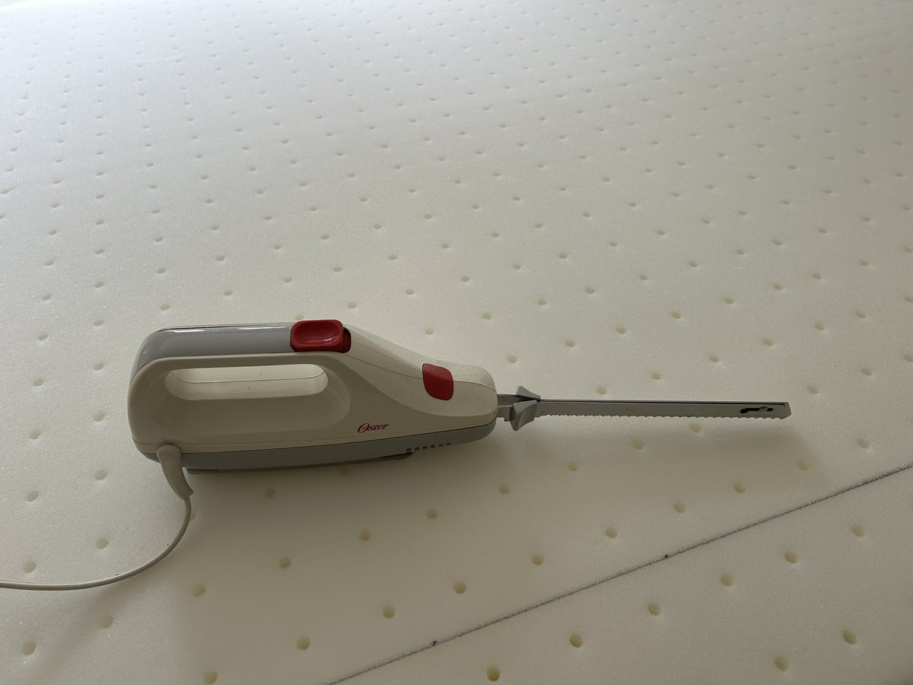
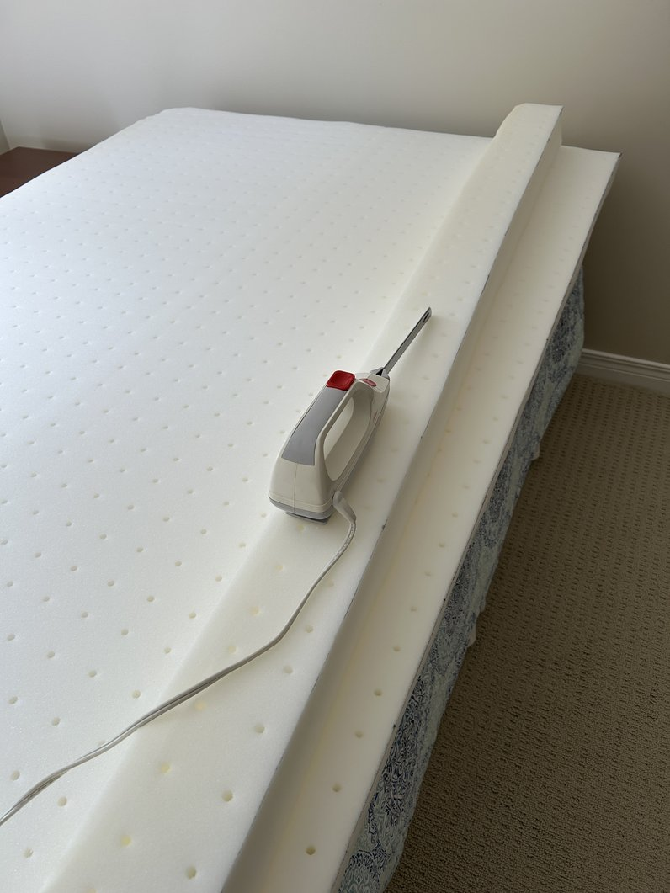
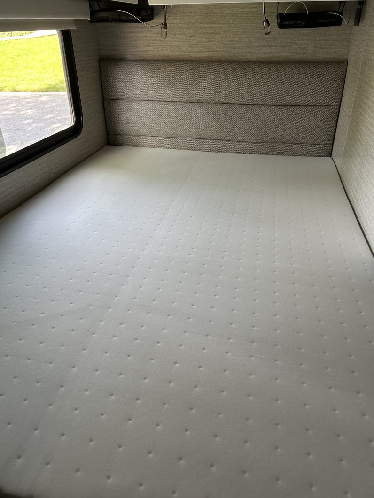
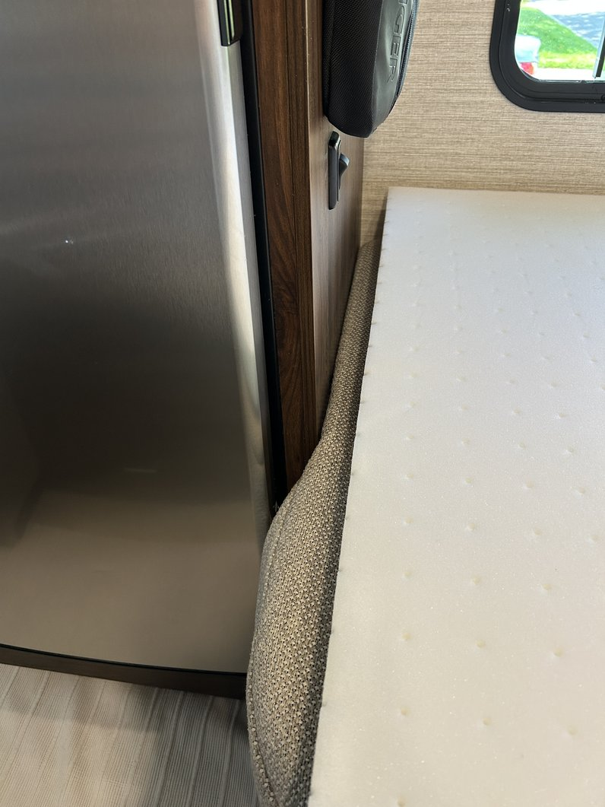
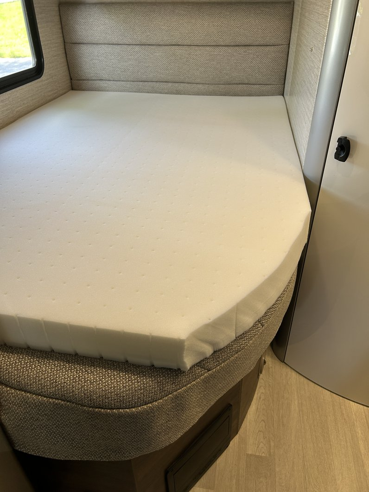
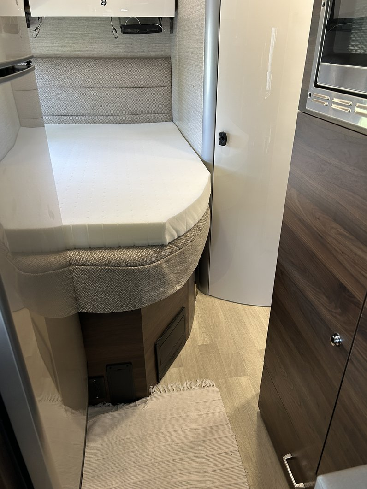

The mattress in our 24J worked really well for us for many years.  And then, I guess we got old.  

It's quite possible that the factory mattress is still comfortable for many Rvers, but our aging backs needed some more support.  We came up with the idea of a mattress topper that was firmer than the factory mattress, so started researching our options.  We settled on a BedStory 4 inch firm mattress from Amazon - it seemed like a good enough price to do some experimenting, so we ordered it with fingers crossed.

The size we chose was a Full / Double, at 54" x 74":

<a href = "https://www.amazon.ca/dp/B0GC5CWMNV?ref=ppx_yo2ov_dt_b_fed_asin_title&th=1 " target="_blank">BedStory Four Inch FIRM Mattress Topper </a>

<h2> Making it Fit </h2>

The Full / Double size is pretty close to the footprint of the factory mattress, but we needed to trim the right hand side by about four inches.  (The mattress has two different levels of firmness, depending on what you want.  We went for the firm side up, and trimmed the right hand side to fit the bedroom width.)  After researching online how to get a clean, straight, cut on a mattress topper, I was disappointed to learn that I did not have to go out and buy a new super cool tool.  The overwhelming opinion from the web was all that you needed to use to cut one of these up was an ... electric carving knife.  Right, I know.  An electric carving knife.  Well, we had one of those in the kitchen, so after convincing my other team member that it would be Ok, we got to work.

We used a straight edge and a felt pen to mark the cut line:

The cut was surprisingly clean:

And the fit pretty nice:

This photo shows that the 74" length was not perfect, but acceptable:

I rounded the corner to match the factory mattress:

Here is the finished trimming job:

There was no off-gassing odour, which surprised us.

The topper comes with a good cover, and looks as good as it does in the advertising material.  We needed a "deep" fitted sheet to cover both the topper and the factory mattress, but it worked out well from an esthetic point of view.  To finish off we put a Twin size comforter on top.  Now, it has made a tall bed even taller - so we're using a fold up step stool to make the grand ascent.  During the day it stores away between the bed and the bathroom wall, in our 24J model.

Was this all worth it?  

Yes.  Absolutely.  No question about it.  It is now likely the most comfortable mattress we have slept on.  

Working better than expected.

 

[Back to Our RV Modifications](/ourmods/)

